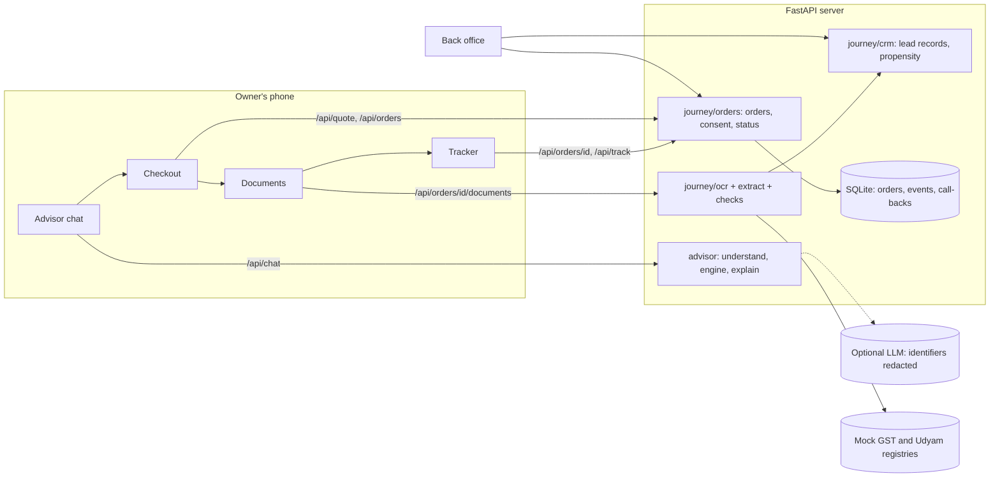

# Udyam Digital: a small business goes digital in one sitting

A phone-first journey for Accel Business (YTL Hackathon 2026, Enterprise Track A). The owner describes
the business in English, Hindi or another Indian language, gets one bundle with one monthly price,
checks out, verifies the business with documents in minutes, and follows the order instead of
calling support. Sales and channel partners get a back office with the leads the advisor couldn't
close and a propensity score for who to call.

| Brief | Built |
| --- | --- |
| Advisor | Chat (text or voice): English and Hindi built in, 8 more Indian languages when an LLM is configured (the chat says so once if it isn't). Asks only what's missing, recommends from the catalogue with a reason per line |
| Quote and checkout | One monthly price with GST, add-on toggles, quantity changes; prices always recomputed on the server; the mobile number is verified by an SMS code (a stub in this build) before an order is placed |
| Smart KYC | Consent screen, document upload with OCR, quality checks, mock GSTIN and Udyam lookups, cross-checks, re-check of the plan |
| Tracker | Status timeline with expected dates per product, by private link or order ID + mobile |
| Stretch goals | Voice input; back office (orders, KYC review, call-back requests, dropped leads to re-engage); propensity score |
| From the leads data | Nine signals tested in `scripts/signals.py`; eight hold, and each one drives a feature: tier-aware install dates, a 5G AirFiber offer when fibre can't reach the site, a text at every status change, orders at risk flagged for staff, a channel for every call-back (visit, call or self-serve link), the link's source kept for scoring, and referral links. See [What the leads data says](#what-the-leads-data-says-and-what-it-changed) |

Runs with no API key and no paid service. **Design rule: the LLM understands and explains; it never
decides what is sold, what it costs or whether KYC passes.**

## Run it

**Windows:** double-click `run.bat`. **macOS / Linux:** `./run.sh`. Python 3.10 or newer.

The script creates a virtual environment, installs `requirements.txt`, then tries the OCR packages in
`requirements-ocr.txt` (RapidOCR: pip only, offline, models included). If those fail to install, the
app still runs: KYC uses Tesseract if installed, or customers type the details.

| Page | Address |
| --- | --- |
| Customer app | <http://127.0.0.1:8000> |
| Back office | <http://127.0.0.1:8000/backoffice> (the key is printed by `run.sh` / `run.bat` on first start and saved as `BACKOFFICE_KEY` in `.env`; the old key `accel-demo` works only with `DEMO_MODE=1`) |
| API docs | <http://127.0.0.1:8000/docs> |

Manual setup (PowerShell):

```powershell
py -3 -m venv .venv
.venv\Scripts\activate
pip install -r requirements.txt
pip install -r requirements-ocr.txt
python make_env.py        # creates .env and a random back-office key
python app.py
```

Without `make_env.py`, a server with an empty `BACKOFFICE_KEY` makes a random key at every start and prints it
in the console.

Optional, faster OCR: install Tesseract (Windows: the UB Mannheim installer). It is found on PATH or
in `C:\Program Files\Tesseract-OCR`; otherwise set `TESSERACT_CMD`. `/api/backoffice/health` (with the back-office key) shows the OCR
engine in use. Measured on a single-core sandbox: Tesseract under 1 s per page, RapidOCR about 3 s
(a clean applicant's four documents verified in about 15 s); a laptop is faster.

## Three-minute demo

1. Click the example **Sample KYC applicant (K03)**: a furniture workshop in Nagpur with the K03 applicant's
   GSTIN. Documents are checked against the order, so an automatic approval needs an order for the documents' own
   business. The plan appears with one monthly price; toggle an add-on.
2. **Continue to checkout.** Change a quantity (the server re-prices). Enter the name **Joseph Singh** (the
   K03 applicant: the ID has to belong to the person who orders) and any mobile number, then **Send code**. On
   a local demo the code is shown on screen; **Verify**, then **Place order**.
3. Read the consent screen and agree. Under "Demo: try a sample applicant", pick **K03** and **Load
   sample**. All four documents are read and verified. **Submit documents.**
4. The tracker shows "Documents verified" and a date for each product.
5. Open the back office with the key and your name, open the order, click **Schedule the visit** (a double
   click still moves it one stage). In the customer app, **Track order** with the order ID and mobile shows
   "Installation scheduled". Switch the language to हिन्दी: the order stays on screen.
6. Show a problem: place another order and load **K01** (cancelled GSTIN, no Udyam number), **K10** (ID holder
   isn't the contact on record), or use the "Shop without GST" example (a salon in Jaipur) with **K03**: the
   documents are for a furniture workshop in Nagpur, so the order goes to a team check instead of being verified.
7. Show the signals at work. The K03 plan says "ready in about 7 days" and explains the 2 extra days (Nagpur is tier 2).
   In the back office, on a verified order, click **No fibre: offer 5G AirFiber**: the customer gets a text, and the
   tracker shows the offer (what changes, the new price) with **Switch to 5G AirFiber**. The call-back table and the
   dropped-lead list say which channel each one deserves, and the last section lists every signal with its number.
   Open the app as `/?src=whatsapp` to see the order credited and scored as a WhatsApp lead.

## What the leads data says, and what it changed

`scripts/signals.py` (pandas, scipy, scikit-learn: `pip install -r requirements-analysis.txt`) recomputes every number
from the CSVs and writes `reports/signals_report.md` (all slices and tests) and `reports/signals.json` (what the back
office shows). Each claim carries its own test. Version 2 audited version 1 and fixed its logic (the report's "What
changed" table): one denominator for pre-quote drops; reach measured as leads never reached rather than the reason mix
(about 70% for every source); the routing insight actually tested; the tier gap measured on the same bundle; the
GSTIN rule judged by the registry, not the lead's yes/no; and a banding bug that put all 5,000 leads in one site band.

| Signal (from 5,000 leads, 368 activations) | What we built | Where |
| --- | --- | --- |
| **GSTIN.** 9.6% activate with one, 2.0% without; at the paperwork step 81% vs 25%. Holds in every segment. Udyam helps at the same step (odds x1.6) | The advisor asks for the GSTIN before any plan and checks the registry; no GST-only products without an active GSTIN; KYC works with Udyam (or a declaration), ID and a bill; "I don't have GST" re-prices | engine, dialogue, checks, orders |
| **Friction.** 48% of the 2,545 leads lost before a quote blame the visit or the quote, 24% the price; price is the biggest single objection at the steepest step, worst for micro shops | Chat instead of a visit, one monthly price, toggles, a lower-cost plan | advisor |
| **Reach.** WhatsApp and website leads are never reached 35% of the time vs 18%; the reason mix is the same | Self-serve from the link; the mobile number verified by a code; `?src=` kept on the order and used in the score | `static/app.js`, `app.py`, `journey/crm.py` |
| **Chases.** Each chase costs 0.37 NPS points and raises churn odds x1.4; churn 6% after one chase, 28% after five. Unrelated to waiting time (r = 0.01) | A text at every status change (stub gateway); tracker visits counted; orders being chased, past their date or without documents are flagged and listed first | `journey/notify.py`, `journey/orders.py` |
| **Install.** Tier 2 passes the last step 52% vs 73%; the same bundle takes 1.75 days longer there; "site not feasible for fibre" 9.5% vs 4.6% | Promised dates add the measured 2 days in tier 2 (not for same-day items like SIMs); when the survey finds no fibre, staff offer 5G AirFiber and nothing changes until the customer accepts | `advisor/peers.py`, `advisor/engine.py`, `journey/orders.py` |
| **Routing.** Field sales spends ₹51,445 per activation on low-score leads vs ₹15,774 on the rest. Ranking by expected value (score x typical bundle) puts 70% of activated revenue in the top fifth vs 48% by score alone (69% vs 55% on later leads) | Every call-back and dropped lead gets a channel: a visit or partner when a month of expected revenue covers a visit (₹1,850), a call when it covers a call (₹320), else the self-serve link. Someone who asked to talk always gets at least a call | `journey/crm.py` (Router) |
| **Referral.** 14.8% activate (2x) at ₹4,099 per activation and pass every step more often; churn 25% vs 13% (not significant with controls) | An active customer's tracker offers a share link; orders through it are credited to the referring order (self-referrals ignored) | `journey/orders.py`, `static/journey.js` |
| **Segments.** Micro retail: 54% of leads, 4.1% activate, 8 months to recover ₹20,007 of acquisition cost at ₹2,505 a month | Routing sends 98% of micro leads to the self-serve link and none to a visit | `journey/crm.py` |
| **Mis-selling** (not supported). No mis-sell measure shows higher churn; 56 of 368 sold bundles break a catalogue rule | Keep the engine's catalogue rules; measure chases and time to activate instead | `scripts/backtest.py` |

Also from the data: channel partners are paid 1.5 months of the bundle when a lead activates, so the digital journey
keeps crediting their leads (matched by documents) rather than competing with them.

## How it works



### Advisor (part 1)

```
message ─► redact GSTIN, Udyam, PAN, Aadhaar, phone, email
        ─► understand: LLM returns JSON (type-checked and clipped)   fallback: keyword/regex parser
        ─► profile (business type, city, staff, sites, GST, needs, budget, quantities)
        ─► ask for the 1-2 most important missing facts (each asked at most twice, then assumed)
        ─► ENGINE (deterministic)
             eligibility   city tier, min employees, min sites, active GSTIN (checksum + mock registry)
             link choice   fibre tier / 5G AirFiber when no fibre / leased line for factories
             needs         stated needs -> products; ineligible ones get the closest alternative
             dependencies  requires_one_of resolved (adds a connection, or drops the item with a reason)
             sizing        per-site items x sites; SIMs, email, devices from staff (peer ratios)
             peers         what similar businesses bought (368 activations, smoothed by segment)
             pricing       list price, setup, GST, contract, install days
        ─► plan + cheaper option + add-ons + "not included" (with reasons) + assumptions
        ─► explain: LLM writes 2-4 sentences from engine facts -> guard -> fallback: templates
```

The guard rejects any explanation that mentions a product outside the plan, quotes a price that is not in the
plan, adds numbers, promises ("guaranteed", "free") or contact details that are not in the facts, or is
empty; the template explanation is used instead. Answers about a product are checked the same way.

| Topic | Rule |
| --- | --- |
| Price | Unit price = midpoint of the catalogue range (`PRICE_POSITION`). Past deals sat 48% into the range. |
| Setup and contract | Setup = sum of qty x setup fee; contract = longest minimum contract in the plan. Both match all 368 historical deals exactly. |
| GST | 18% shown separately (`GST_RATE`). |
| GSTIN | Format and check digit validated offline; status from `mock_gstin_registry.csv`. Cancelled, suspended, invalid or unknown GSTINs unlock nothing that needs GST. "Yes, registered" without a number is allowed provisionally and re-checked at KYC; the plan says so. A later "no GST" wins over an earlier number. |
| City | 8 tier-1 and 14 tier-2 cities from the data plus about 40 common tier-2 cities. NCR towns count as Delhi. Unknown cities are priced as tier 2 and flagged. |
| Budget | Compared with the monthly price **including GST**. The cheaper option is shown when it saves at least 15%, or when it is the only plan inside the budget. |
| Dates | `APP_TODAY` = 2026-07-15, as the data pack asks. |

To turn on an LLM, edit `.env`: `LLM_PROVIDER=openai_compat` with `LLM_BASE_URL`, `LLM_API_KEY`,
`LLM_MODEL` (Gemini, Groq, OpenAI or a local Ollama), or `LLM_PROVIDER=anthropic`. After three
failures in a row the LLM pauses for 60 seconds and the advisor carries on with rules.

### Checkout (part 2)

The browser sends only product IDs and quantities; the server re-prices with the same engine and
refuses anything that breaks a catalogue rule. Before an order is placed the mobile number is verified with
a 6-digit code (valid 5 minutes, 5 tries; the SMS gateway is a stub in `journey/otp.py`, and the code is
shown on screen only on a local demo). An order gets an ID (`UD-7K3F9Q`) and a private link. The link's
token is random, shown once, and stored only as a SHA-256 hash. Placing the same order again returns the
same order. A lead record is linked only when a *document* identifier (GSTIN or Udyam number) is confirmed
by the registry, never from a number typed in chat; the order is then credited to that lead's source (field
sales, channel partner, referral), so the digital journey adds to the existing channels instead of competing
with them.

### Smart KYC (part 3)

1. **Consent first.** The server refuses documents until the owner agrees. The notice says what is
   kept, why, how long, and how to withdraw. Offers are a separate, optional tick. Withdrawing (or a
   back-office cancel) deletes the KYC details and cancels the order; the order, plan, mobile number and
   consent record are kept (see PRIVACY.md).
2. **Upload** photos, scans or PDFs, all at once or one per slot. The document type is detected from
   the text (the file name is the fallback). Images are processed in memory and never stored or spooled
   to a temporary file. Limits: 8 MB, 25 megapixels, PDF pages up to 50 inches (the first page only), and
   a per-address upload rate limit.
3. **Quality gates:** blur and size are measured before reading; tilted pages are straightened.
4. **OCR** (Tesseract or RapidOCR) after removing the watermark and tinted backgrounds.
5. **Fields** are found by label, tolerating OCR noise ("Trade n:", "principał"). A GSTIN is repaired
   only where the format forces it (a PAN letter can't be `0`), or where the check digit and the
   registry agree on exactly one reading. A wrong number is never "fixed" into a valid one.
6. **Checks**, recomputed whenever any document changes:

| Document | Checks |
| --- | --- |
| GST certificate | GSTIN format and check digit, found in the registry, status Active, legal and trade name and address match the registry, date of liability matches, same GSTIN as given to the advisor |
| Udyam certificate | number present and valid, found in the registry, name and place match, same business as the GST documents. "Not Udyam-registered" can be declared; it goes to a team check if the lead record says otherwise |
| Signatory ID | still valid, issued for this business, is the proprietor (for proprietorships), is the person who placed the order, is the contact on the lead record (otherwise a team check; the customer never sees the other name) |
| Address proof | bill from the last 90 days, billed to the business or its signatory, address matches the GST registration |
| The plan | re-priced with the verified GSTIN and city; a GST-only product on a cancelled GSTIN is blocked |

Names are compared word by word: OCR look-alikes (`0/o`, `1/l/i`), word order and titles (Shri, Dr, M/s)
are ignored, an initial or a slip in a long word is a **near match** that goes to a team check, and any other
difference (Ramesh and Rakesh, Verma and Varma) is a different person. House and unit numbers must match
exactly. Customers without a GST registration can say so at the GST step: the page shows which products come
out and the new price, and nothing changes until they agree.

Every failure says what is wrong and how to fix it, in English or Hindi. Typed details are accepted
but always go to a team check. Results: **ready** (all verified; submitting verifies the order
automatically), **review** (submitting sends it to the back office), **attention** or **incomplete**
(submit is disabled).

The 12 specimen applicants, read by the real OCR engine (both Tesseract and RapidOCR give these
results, on a matching order and on an unrelated one):

| Applicant | Result |
| --- | --- |
| K01 | Needs attention: GSTIN cancelled in the registry; Udyam certificate has no number |
| K02 | Verified (photo tilted 7°, straightened before reading) |
| K03, K08, K09, K12 | Verified |
| K04 | Needs attention: GST certificate too blurry, retake asked |
| K05 | Incomplete: Udyam certificate missing |
| K06 | Needs attention: GSTIN fails the check digit (altered number) |
| K07 | Needs attention: legal name differs from the GST registry |
| K10 | Team check: ID holder isn't the contact on the lead record |
| K11 | Needs attention: electricity bill older than 90 days |

Not flagged on purpose: Udyam registration dates and "major activity" differ from the registry on
most specimens, including clean ones, and 379 registry GSTINs are dated before GST began. These look
like data-generation noise; flagging them would fail clean applicants.

### Tracker (part 4)

Order placed → documents verified → installation scheduled → installed → services live, with dates,
the next step in plain words, and an expected date per product from the catalogue's install times plus the measured
allowance for the city's tier (2 days in tier 2, only for products that need an installation; the plan and checkout
show the same dates and say why). The customer gets a text at every status change, so there is nothing to chase.
When the site survey finds no fibre, the tracker shows the 5G AirFiber offer (what changes, the new price, the new
dates); accepting it re-plans the order, declining asks for a call. An active customer sees a referral link.
The private link also allows uploads and answers; order ID + mobile gives a read-only view (rate-limited).

### Back office and propensity score

`/backoffice` lists orders with the team checks first, then orders at risk: the customer opened the tracker 3 times
since the last update, the promised date has passed, or no documents came within 2 days. Opening an order shows its
KYC findings, including details hidden from the customer, the texts sent, tracker visits and the history. Staff can
approve or send back KYC, move orders to the next stage, and offer 5G AirFiber when fibre is not feasible (or record
that the customer agreed on a call). It also lists call-back requests ("Talk to an expert" in the app) and the 25
dropped leads most worth calling again, with what to offer each and the channel each deserves, plus how last
quarter's leads would have been routed and the signals table from `reports/signals.json`.

The propensity score is a logistic regression on facts known when a lead arrives: segment, source,
city tier, GSTIN, Udyam, current internet, staff, sites, spend and language. Stage dates and costs
are left out because they would leak the outcome. **AUC 0.71 ± 0.04 (5-fold cross-validation over the 5,000
leads); a single 80/20 split gave 0.635, and the one-line rule "has a GSTIN" alone gives 0.61**, against an
average activation rate of 7.4%. That is weak to moderate: good enough to order a call list. The call
list is ranked with out-of-fold scores (a model that never saw the lead). Bands: High = at least twice the
average, Medium = above average. It ranks leads for calling; it does not decide anything for a customer.
The list covers the drop reasons the digital journey removes, including document mismatches, cancellations
before install and delays beyond 21 days.

## API

| Endpoint | Use |
| --- | --- |
| `POST /api/chat` | The conversation. Returns `reply`, `chips`, `understood`, and `recommendation` once ready. Optional `source` and `ref` come from the link (`?src=whatsapp`, `?ref=R-XXXXXX`). |
| `POST /api/recommend` | Profile in, plan out. |
| `POST /api/quote` | Re-price any item list and list every rule it breaks. |
| `POST /api/otp/send`, `POST /api/otp/verify` | Mobile check. `verify` returns a single-use `otp_token` for the order. |
| `POST /api/orders` | Place an order: `{session_id, items, contact: {name, mobile}, otp_token}`. Returns the ID and private token. |
| `GET /api/orders/{id}` | Order status (header `X-Order-Token`). |
| `POST /api/orders/{id}/proposal` | Accept or decline the 5G AirFiber offer: `{"accept": true}` (header `X-Order-Token`). |
| `POST /api/track` | Read-only status by `{order_id, mobile}`. |
| `GET /api/orders/{id}/kyc` | Documents, checks and what is still needed. |
| `POST`, `DELETE /api/orders/{id}/consent` | Give or withdraw KYC consent. |
| `POST /api/orders/{id}/documents` | Upload one file (multipart `file`, optional `doc_type`). |
| `POST /api/orders/{id}/documents/{type}/manual` | Type the details instead. |
| `POST /api/orders/{id}/documents/{udyam_certificate\|gst_certificate}/not-registered` | Declare no registration. For GST the first call answers `409 confirm_requote` with what would be removed and the new price; repeat with `{"confirm": true}` to apply. |
| `DELETE /api/orders/{id}/documents/{type}` | Remove a document. |
| `POST /api/orders/{id}/kyc/submit` | Submit: verified automatically, or sent for a team check. |
| `GET /api/registry/gstin/{gstin}`, `GET /api/registry/udyam/{number}` | Mock government lookups. |
| `POST /api/handoffs` | Request a call back (needs the customer's permission). |
| `GET /api/backoffice/summary`, `POST /api/backoffice/orders/{id}/{action}` | Back office (header `X-Backoffice-Key`). Actions: `approve`, `send-back`, `schedule`, `install`, `activate`, `cancel`, `airfiber`, `accept-airfiber`, `drop-proposal`. |
| `GET /api/health` | Liveness only: `{"status": "ok"}`. |
| `GET /api/config` | What the page needs: AI on or off, languages that work offline, mobile-check switches. |
| `GET /api/backoffice/health` | Data loaded, LLM status, OCR engine (header `X-Backoffice-Key`). |

## Configuration (`.env`)

| Setting | Default | Meaning |
| --- | --- | --- |
| `LLM_PROVIDER` | `none` | `none`, `openai_compat` or `anthropic` |
| `OCR_ENGINE` | `auto` | `auto` (Tesseract, else RapidOCR), `tesseract`, `rapidocr`, `none` (typed details) |
| `TESSERACT_CMD` | | Path to `tesseract.exe` if it isn't on PATH |
| `BACKOFFICE_KEY` | random | Back-office key. `run.sh` / `run.bat` save a random one on first start; if empty, one is made (and printed) at every start |
| `DEMO_MODE` | `0` | `1` = local demo only: the fixed key `accel-demo`, specimen documents and on-screen codes |
| `DEMO_SAMPLES` | on for a local server | Offer the data pack's specimens as one-click samples. Off on any other `HOST` unless set to `1` |
| `OTP_REQUIRED` | `1` | Verify the mobile number before an order is placed |
| `DEMO_OTP` | on for a local server | Show the verification code on screen (there is no SMS gateway in this build) |
| `MAX_UPLOAD_MB` | `8` | Largest accepted file |
| `UPLOAD_RATE` | `40` | Document uploads per address in 10 minutes |
| `CORS_ORIGINS` | none | Comma-separated origins allowed to call the API from another site |
| `HOST`, `PORT` | `127.0.0.1`, `8000` | Where the server listens |
| `DB_PATH` | `var/udyam.db` | SQLite file for orders |
| `APP_TODAY` | `2026-07-15` | The data pack's "today" for dates and the 90-day rule |

## Tests

```bash
python -m pytest -q                       # 404 tests; the 12-applicant answer key runs on the first installed OCR engine
KYC_ALL_ENGINES=1 python -m pytest -q     # 416 with both OCR engines installed: the answer key on every installed engine
python -m pytest -q -m "not ocr"          # fast subset, no OCR needed
python scripts/backtest.py                # replays all 5,000 leads through the engine
python scripts/signals.py                 # recomputes reports/signals_report.md and reports/signals.json
```

The tests cover the engine (1,500 random profiles that must never break a catalogue rule), the LLM
path against a mocked provider, KYC parsing and repair, the answer key, and the HTTP journey:
- server-side pricing that ignores tampered prices
- token access and the read-only tracker
- consent before upload, and withdrawal deleting data
- typed details going to review and the team approving them
- the plan re-check blocking a GST-only product
- bad uploads, the back-office key, the mock registries, rate limits

`tests/test_signals.py` covers the features built from the leads data: the measured tier allowance and dates that
agree from plan to tracker, the AirFiber offer (nothing changes until the customer answers; fibre-only products come
out), a text at every status change with no personal details, tracker visits counted once per half hour, risk flags,
routing from the data's channel costs, link sources in the score, referrals (self-referrals ignored), and the report
(the shipped `reports/signals.json` must equal a fresh run of `scripts/signals.py`; skipped without pandas and scikit-learn).

`tests/test_audit_fixes.py` holds one regression test or more for each finding of the code audit
(see `AUDIT_FIXES.md`): the size and GST parsing, redaction and logging, sessions, budgets and GST,
the LLM guards, the mobile check, data deletion, upload limits, name matching and the call list.
`tests/test_audit2_fixes.py` does the same for the second audit (KYC-01 ... REQ-01), including its judge-style
scenarios T01 to T15: documents checked against the order, stage actions that cannot be skipped, one-transaction
saves, multi-page PDFs, staff and site words, per-outlet counts, off-catalogue asks and the calibrated model.

Backtest on the 5,000 leads: 0 engine plans break a catalogue rule, while 56 of the 368 bundles the
field force sold did (for example 1 Gbps in tier-2 cities and Static IP without fibre). Median time
per plan is 0.33 ms.

## Project layout

```
app.py                   FastAPI app and routes
advisor/                 part 1: engine, dialogue, understanding, explanations, LLM client, registry, privacy
journey/
  orders.py              checkout, KYC actions, tracker, back-office actions, call-backs, risk flags, AirFiber offer
  notify.py, sms.py      a text at every status change; the SMS gateway stub shared with the mobile check
  ocr.py                 image loading, blur/size/tilt checks, watermark cleanup, Tesseract and RapidOCR
  extract.py             document type, field parsing, GSTIN/Udyam/date repair, name and address matching
  checks.py              KYC checks, Udyam registry, plan re-check
  crm.py                 lead records, the propensity model, channel routing (Router)
  otp.py                 mobile check (SMS stub)
  store.py               SQLite storage
  texts.py               customer texts in English and Hindi
static/                  no build step: index.html, app.js (advisor), journey.js (checkout, KYC, tracker),
                         backoffice.html, backoffice.js, styles.css
tests/                   pytest suite
scripts/backtest.py      replays the leads
scripts/signals.py       finds and tests the signals in the leads data (requirements-analysis.txt)
reports/                 signals_report.md and signals.json, written by scripts/signals.py
data/                    the data pack: four CSVs and kyc_documents/
make_env.py             first-run helper: creates .env with a random back-office key
PRIVACY.md               privacy and security note
AUDIT_FIXES.md           the code audit's findings and how each was fixed
ROADMAP.md, FIX_LOG.md    the order the fixes were made in, and a log of each step
audit/                   the second audit's probe and two headless-browser checks (see AUDIT_FIXES.md)
```

## Known limits

- One server process: advisor sessions and rate limits are in memory, orders in SQLite.
- Registries are the mock CSVs. DigiLocker, Aadhaar e-sign and payment are not connected (see PRIVACY.md).
- OCR is tuned on the data pack's specimens; real phone photos with glare or folds need more testing.
- The back office uses one shared key; production needs sign-in with roles (a partner sees only their leads).
- Without an LLM, understanding covers English, Hindi and Hinglish keywords. Screens are in English
  and Hindi; other languages get LLM-written replies in the chat, and without an LLM the chat says so once
  and carries on in English.
- Voice input uses the browser's speech recognition (best in Chrome); the audio is handled by the browser
  vendor, not this server. The page also loads its typeface from Google Fonts (see PRIVACY.md).
- The SMS gateway is a stub (order updates and codes are logged as "queued", without their text), and the GST and
  Udyam registries are mock files.
- Risk flags are computed when the back office loads; nothing sends a reminder on a timer. Referral codes credit the
  referring order but carry no reward. Link sources are taken as given (`?src=`); a partner's own ID is not tracked.
- The routing rule assumes a channel changes cost, not the chance a lead activates: the data has no experiment that
  would show how much a visit adds.
